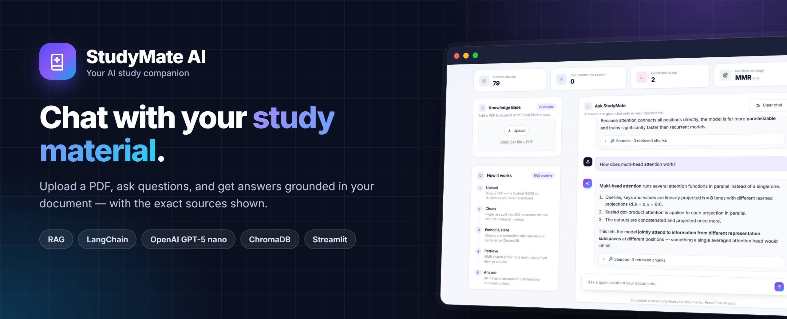
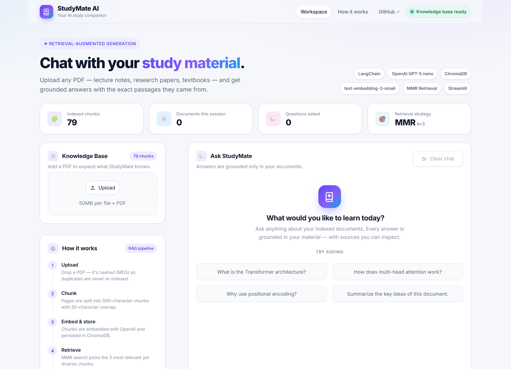
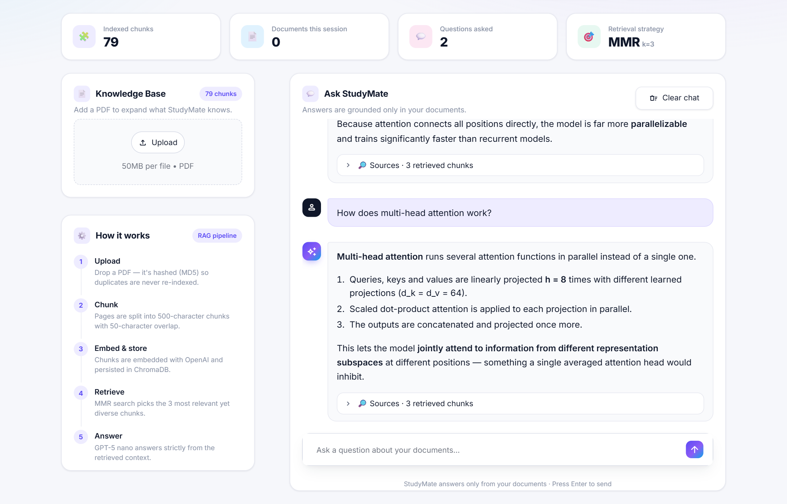
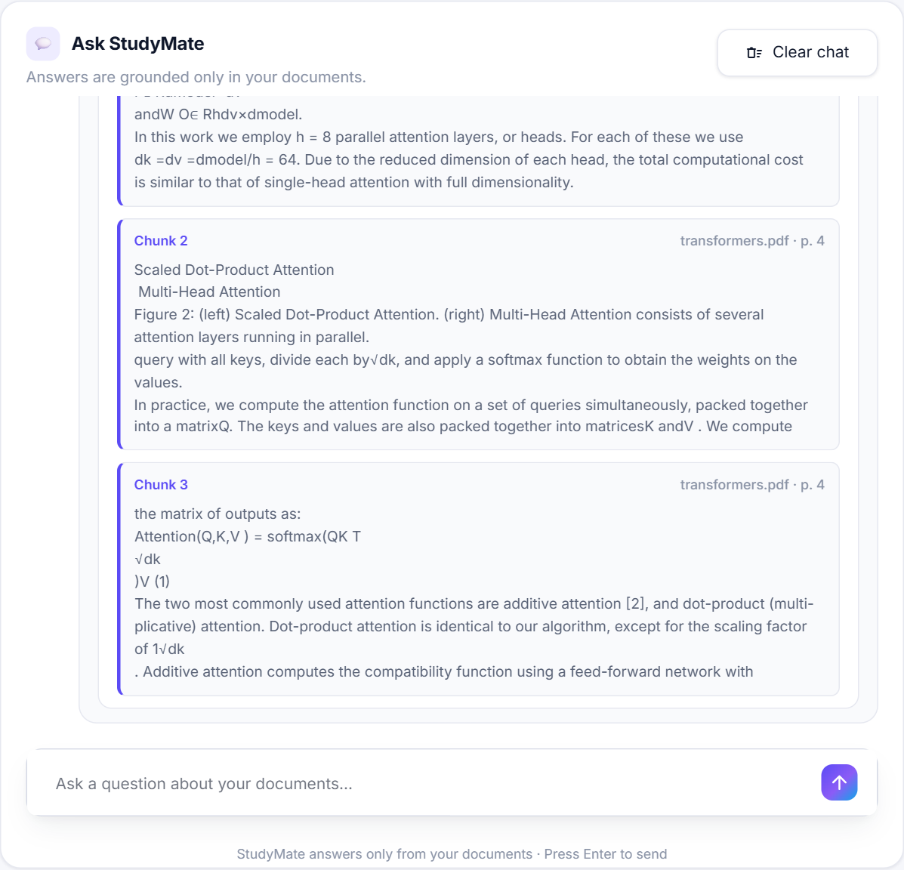
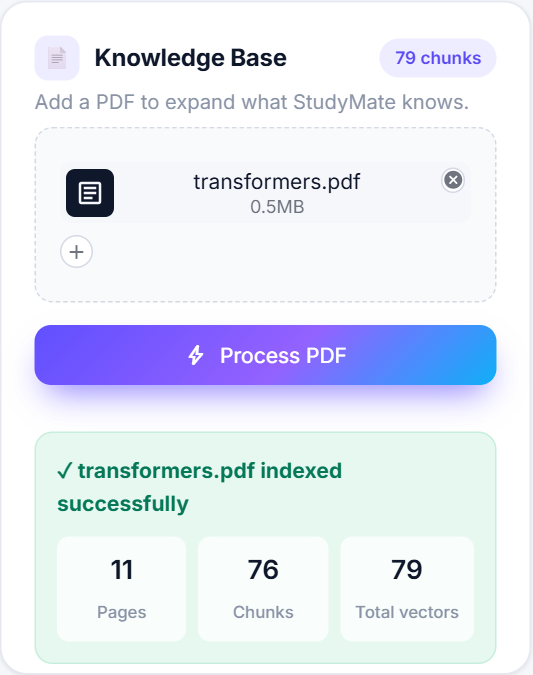
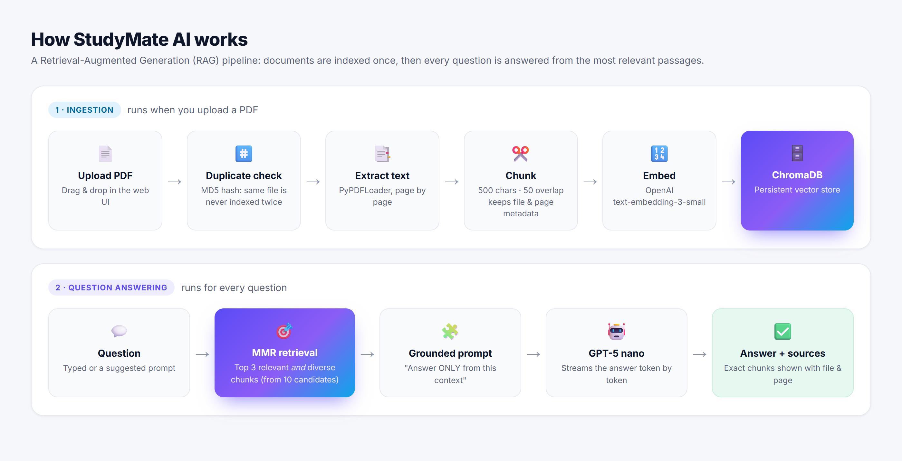

<p align="center">
  
</p>

<p align="center">
  
  
  
  
  
</p>

<h3 align="center">An AI study assistant that answers questions from <i>your</i> PDFs and shows exactly where each answer came from.</h3>

---

## 📌 The project in 30 seconds

| | |
|---|---|
| 🎯 **What it is** | A web app where you upload a PDF (notes, textbook, research paper) and chat with it. |
| ❗ **The problem** | Reading long documents is slow, and ChatGPT-style bots often **make up answers** that aren't in your material. |
| ✅ **The solution** | **Retrieval-Augmented Generation (RAG):** the app finds the most relevant passages in your PDF and the AI answers **only from them**, with sources shown for every answer. |
| 🛠️ **Built with** | Python · LangChain · OpenAI GPT-5 nano · OpenAI Embeddings · ChromaDB (vector database) · Streamlit + custom CSS |
| 👩‍💻 **My role** | Designed and built the whole thing: the AI pipeline, the vector database, and the web UI. |

---

## 🖥️ What it looks like

<p align="center">
  
  <br/><sub><b>Home screen:</b> live stats, PDF upload, a step-by-step explanation of the pipeline, and suggested questions to get started.</sub>
</p>

<br/>

<p align="center">
  
  <br/><sub><b>Chat:</b> ask questions in plain English. Answers stream in live and are formatted for easy reading.</sub>
</p>

<br/>

<table>
  <tr>
    <td width="62%" valign="top" align="center">
      
      <br/><sub><b>Sources:</b> every answer shows the exact passages it used, with file name and page number, so it can be checked.</sub>
    </td>
    <td width="38%" valign="top" align="center">
      
      <br/><sub><b>Upload:</b> one click to index a PDF. Uploading the same file twice is detected automatically.</sub>
    </td>
  </tr>
</table>

---

## ⚙️ How it works

<p align="center">
  
</p>

**In plain words:**
1. **You upload a PDF.** The app splits it into small overlapping pieces and turns each piece into a numerical "meaning fingerprint" (an *embedding*). These are stored in a vector database (**ChromaDB**).
2. **You ask a question.** The app finds the 3 pieces whose meaning is closest to your question, using **MMR**, which also avoids picking near-duplicate pieces.
3. **The AI answers.** GPT-5 nano gets only those pieces and is instructed to answer **strictly from them**. If the answer isn't there, it says so instead of guessing.

---

## ✨ Key features

| Feature | Why it matters |
|---|---|
| 📄 **PDF to knowledge base in one click** | Any document becomes searchable in seconds |
| 🛡️ **Grounded, no-hallucination answers** | The AI may only use your document; otherwise it says *"I could not find the answer in the document."* |
| 🔎 **Source citations** | Every answer shows the exact passages, file and page it came from |
| 🎯 **MMR retrieval** | Picks passages that are relevant **and** diverse, for fuller answers |
| ♻️ **Duplicate detection** | MD5 file hashing stops the same PDF from being indexed twice |
| ⚡ **Streaming responses** | Answers appear word by word, with an automatic fallback if streaming fails |
| 💾 **Persistent storage** | Indexed documents survive app restarts |
| 🎨 **Product-grade UI** | A custom web-app design built on Streamlit: navbar, dashboard cards, chat bubbles, loading screen |

---

## 🧠 What this project demonstrates

- **Generative AI / LLM engineering:** an end-to-end RAG system, prompt design for grounded answers, embeddings, and vector search.
- **Applied ML judgment:** choosing chunk size and overlap, MMR over plain similarity search, and preventing hallucinations.
- **Backend engineering:** document ingestion, deterministic IDs, deduplication, persistent storage, and error handling.
- **Performance work:** cut app start time from **~45s to ~5s** by finding heavy imports (PyTorch loaded through LangChain) and loading them only when needed.
- **Frontend / product sense:** turned a default Streamlit page into a polished, responsive web app with a custom design system (HTML/CSS).

---

## 🛠️ Tech stack

| Layer | Technology |
|---|---|
| Large language model | OpenAI **GPT-5 nano** |
| Embeddings | OpenAI **text-embedding-3-small** |
| AI orchestration | **LangChain** (loaders, text splitters, retrievers, prompts) |
| Vector database | **ChromaDB** (persistent, on disk) |
| PDF parsing | PyPDF (`PyPDFLoader`) |
| Web app / UI | **Streamlit** + custom HTML/CSS design system |
| Config | python-dotenv, `.streamlit/config.toml` |

---

## 🚀 Run it locally

```bash
# 1. Clone
git clone https://github.com/bhoomikaaa20/StudyMate_AI.git
cd StudyMate_AI

# 2. Create a virtual environment and install dependencies
python -m venv .venv
.venv\Scripts\activate          # Windows
# source .venv/bin/activate     # macOS / Linux
pip install -r requirements.txt

# 3. Add your OpenAI key
echo OPENAI_API_KEY=sk-your-key > .env

# 4. (Optional) pre-load the sample paper, "Attention Is All You Need"
python main.py

# 5. Start the app, then open http://localhost:8501
streamlit run app.py
```

<details>
<summary><b>📁 Project structure</b></summary>

```
StudyMateAI/
├── app.py                  # Web app: RAG pipeline + page layout
├── ui/
│   ├── components.py       # UI building blocks (navbar, hero, stat cards, sources)
│   └── styles.css          # Design system: colors, cards, chat bubbles, responsive rules
├── .streamlit/config.toml  # Theme and server settings
├── main.py                 # Script: index the sample PDF into ChromaDB
├── db.py                   # Terminal version of the RAG chatbot
├── document_loaders/       # Loader / splitter experiments + sample PDF
├── retreivers/             # Retriever experiments (MMR, multi-query, arXiv)
├── vectorStore/            # Vector store experiments
├── chroma_db/              # Persisted vector database
└── assets/                 # README images and screenshots
```
</details>

---

## 🔮 What's next

- Support for DOCX, TXT and web pages
- Follow-up questions that remember the conversation
- Quiz and flashcard generation from your material
- Public deployment on Streamlit Community Cloud

---

<p align="center">
  Built by <a href="https://github.com/bhoomikaaa20"><b>bhoomikaaa20</b></a> · If you like this project, please give it a ⭐
</p>
