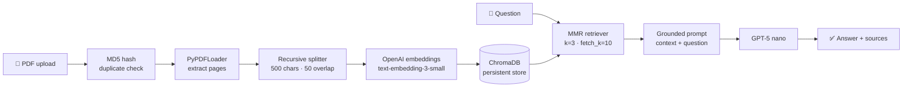

<div align="center">

# 📚 StudyMate AI

### Chat with your study material — grounded answers, with sources.

A **Retrieval-Augmented Generation (RAG)** web app that turns any PDF — lecture notes, research papers, textbooks — into an AI study companion you can ask questions to. Every answer comes only from your document, and you can open the exact passages it was built from.


</div>

---

## ✨ At a glance

| | |
|---|---|
| **Problem** | Studying from long PDFs is slow, and general-purpose chatbots hallucinate answers that aren't in your material. |
| **Solution** | StudyMate indexes your PDF into a vector database and answers questions **strictly from the retrieved passages**, showing the sources for every answer. |
| **What I built** | The end-to-end RAG pipeline (ingestion → chunking → embeddings → vector search → grounded generation) and a custom, product-style web UI on top of Streamlit. |
| **Tech** | Python · LangChain · OpenAI (`gpt-5-nano`, `text-embedding-3-small`) · ChromaDB · Streamlit · custom HTML/CSS |

---

## 🖼️ Screenshots

### 1. Workspace: dashboard, knowledge base and chat
A clean, web-app style landing page: live stats, a drag-and-drop knowledge base, the RAG pipeline explained, and one-click suggested questions.


### 2. Ask questions and get grounded answers
Answers stream in token by token, formatted in Markdown. Conversation history is kept for the session.


<table>
<tr>
<td width="62%" valign="top">

### 3. Transparent sources
Every answer has a **Sources** panel showing the exact chunks retrieved from the vector database, with the file name and page number. You can verify each answer against the original text.


</td>
<td width="38%" valign="top">

### 4. Upload and index any PDF
Upload a PDF and click **Process**. The app reports pages, chunks and total vectors. Re-uploading the same file is detected (MD5 hash), so nothing is indexed twice.


</td>
</tr>
</table>

---

## 🧠 How it works



**Ingestion**
1. **Upload:** the PDF is hashed with MD5. Files already processed in the session are skipped.
2. **Load and chunk:** `PyPDFLoader` extracts pages, then `RecursiveCharacterTextSplitter` creates 500-character chunks with a 50-character overlap so context isn't lost at chunk boundaries.
3. **Embed and store:** chunks are embedded with OpenAI `text-embedding-3-small` and persisted in **ChromaDB**. Each chunk gets a deterministic ID (`<hash>_<index>`) and keeps its source file name and page number.

**Question answering**

4. **Retrieve:** a **Maximal Marginal Relevance (MMR)** retriever fetches 10 candidates and picks the 3 that are most relevant *and* least redundant, so the LLM sees diverse evidence.
5. **Generate:** a strict system prompt tells `gpt-5-nano` to answer **only** from the retrieved context, and otherwise to reply *"I could not find the answer in the document."* This keeps hallucinations down.

---

## 🚀 Features

- **PDF to knowledge base in one click**, with page, chunk and vector counts
- **Duplicate detection** using content hashing
- **Grounded answers** that refuse to make things up when the answer isn't in the document
- **MMR retrieval** for relevant *and* diverse context
- **Source citations** with file name and page for every answer
- **Streaming responses** with a typing effect, plus an automatic fallback to a regular call
- **Persistent vector store**, so indexed documents survive restarts
- **Custom web-app UI:** sticky navbar, hero, stat cards, card layout, chat bubbles, suggested prompts, responsive layout. Streamlit's default chrome is fully restyled.
- **Friendly error handling**, for example a clear message when the API key is invalid

---

## 🛠️ Tech stack

| Layer | Technology |
|---|---|
| LLM | OpenAI `gpt-5-nano` via `langchain-openai` |
| Embeddings | OpenAI `text-embedding-3-small` |
| Orchestration | LangChain (`langchain-core`, `langchain-community`, `langchain-text-splitters`) |
| Vector database | ChromaDB (`langchain-chroma`), persisted to disk |
| Document loading | `PyPDFLoader` (pypdf) |
| Frontend | Streamlit + custom CSS design system (Inter font, design tokens, responsive grid) |
| Config | `python-dotenv`, `.streamlit/config.toml` |

---

## 📁 Project structure

```
StudyMateAI/
├── app.py                  # Streamlit web app: RAG pipeline + page layout
├── ui/
│   ├── components.py       # Reusable UI building blocks (navbar, hero, stats, cards, sources)
│   └── styles.css          # Design system: tokens, cards, chat bubbles, responsive rules
├── .streamlit/config.toml  # Theme and server config
├── main.py                 # CLI script: index document_loaders/transformers.pdf into ChromaDB
├── db.py                   # CLI chatbot over the vector store (terminal RAG loop)
├── document_loaders/       # Loader and text-splitter experiments + sample PDF
├── retreivers/             # Retriever experiments (MMR, multi-query, arXiv)
├── vectorStore/            # Vector store experiments
├── chroma_db/              # Persisted Chroma vector database
└── assets/screenshots/     # README images
```

---

## ⚙️ Getting started

### Prerequisites
- Python 3.14+
- An [OpenAI API key](https://platform.openai.com/api-keys)

### 1. Clone and install
```bash
git clone https://github.com/bhoomikaaa20/StudyMate_AI.git
cd StudyMate_AI

python -m venv .venv
# Windows
.venv\Scripts\activate
# macOS / Linux
source .venv/bin/activate

pip install -r requirements.txt
```
> Using [uv](https://github.com/astral-sh/uv)? Run `uv sync` instead.

### 2. Add your API key
Create a `.env` file in the project root:
```env
OPENAI_API_KEY=sk-...
```

### 3. (Optional) Pre-index the sample PDF
```bash
python main.py
```
This indexes *Attention Is All You Need* (`document_loaders/transformers.pdf`) so you can start asking questions right away.

### 4. Run the app
```bash
streamlit run app.py
```
Open **http://localhost:8501**, upload a PDF (or use the pre-indexed one), and start asking questions.

> 💡 Prefer the terminal? `python db.py` starts a command-line version of the same RAG chatbot.

---

## 🔮 Roadmap

- [ ] Multiple document formats (DOCX, TXT, web URLs)
- [ ] Per-document filtering and a document manager
- [ ] Inline citations inside the answer text
- [ ] Conversation-aware retrieval (follow-up questions)
- [ ] Quiz and flashcard generation from your material
- [ ] Deploy to Streamlit Community Cloud

---

## 👩‍💻 Author

**bhoomikaaa20** · [GitHub](https://github.com/bhoomikaaa20)

If you found this project interesting, consider giving it a ⭐!
